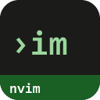
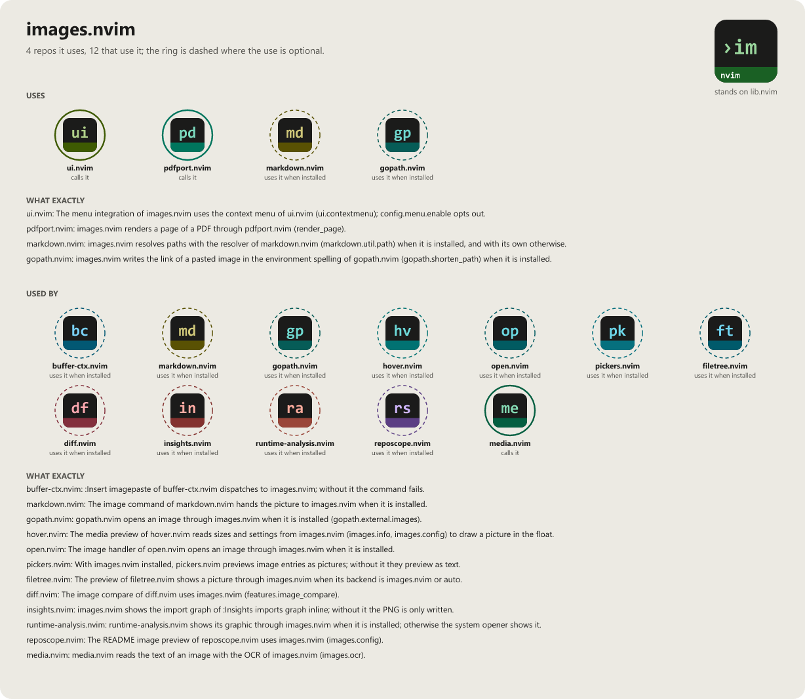

> **Beta stage — active development.** This repository is past its first shape and in
> active use, but the surface is not frozen: breaking changes are still possible. Pin a
> commit or tag if you depend on it.

# images.nvim

```
██╗███╗   ███╗ █████╗  ██████╗ ███████╗███████╗
██║████╗ ████║██╔══██╗██╔════╝ ██╔════╝██╔════╝
██║██╔████╔██║███████║██║  ███╗█████╗  ███████╗
██║██║╚██╔╝██║██╔══██║██║   ██║██╔══╝  ╚════██║
██║██║ ╚═╝ ██║██║  ██║╚██████╔╝███████╗███████║
╚═╝╚═╝     ╚═╝╚═╝  ╚═╝ ╚═════╝ ╚══════╝╚══════╝
                                          .nvim
```

[](LICENSE)
[](https://neovim.io)
[](https://www.lua.org)


[](https://github.com/WKDSteve/images.nvim/actions/workflows/ci.yml)
[](https://wkdsteve.github.io/wkd/p/images/)

> Part of the [wkd](https://wkdsteve.github.io/wkd/) family — see this plugin's [page](https://wkdsteve.github.io/wkd/p/images/) on the site.

images.nvim shows images in the terminal without leaving Neovim: hover a
markdown link, double-click it, or paste a screenshot straight from the
clipboard into the document. It draws through the iTerm2 inline-image
protocol (OSC 1337) instead of the Kitty graphics protocol the alternatives
rely on, which is what makes it work on native Windows Neovim in WezTerm,
where they do not.

---

> **[markdown.nvim](https://github.com/WKDSteve/markdown.nvim)** — resolves
> the link targets this plugin renders: Markdown links, `` tags, `<figure>`
> blocks. It prefers images.nvim as its own in-Neovim preview provider in return.
>
> **[hover.nvim](https://github.com/WKDSteve/hover.nvim)** — answers "what is
> this" about whatever the cursor rests on, in any filetype. images.nvim is its
> picture provider, so a path to a PNG previews as the PNG.
>
> **[pdfport.nvim](https://github.com/WKDSteve/pdfport.nvim)** — meets it from
> both sides: it turns an image into a PDF for `:Image export`, and a PDF page
> back into an image so a `.pdf` entry previews as its first page.
>
> All of the above are soft: without them everything else works unchanged.
> [lib.nvim](https://github.com/WKDSteve/lib.nvim) is the one real
> dependency — see [Requirements](docs/installation.md#requirements).

---

## Documentation

Start at [docs/README.md](docs/README.md) — what's where, and which question
each page answers.

### The Basics

- [Requirements](docs/installation.md#requirements) — Neovim version, the terminal question, and the one required plugin.
- [Installation](docs/installation.md) — plugin managers and optional external tools.
- [Quickstart](docs/quickstart.md) — the first thing to run after installing.

### Configuration

- [What you get with the defaults](docs/what-you-get.md) — the sixteen `:Image` routes and the six keymaps that matter on day one.
- [All options](docs/configuration.md) — every `setup()` option and its default.
- [Commands](docs/commands.md) / [Bindings cheatsheet](docs/BINDINGS.md)

### The Rest

- [What it does and what not](docs/scope.md) — the four feature groups, and the four limits the OSC 1337 decision buys.
- [How the commands combine day to day](docs/WORKFLOW.md)
- [Why it does it that way](docs/architecture.md)
- [Health check](docs/health.md) — what `:checkhealth images` reports, check by check.
- [Troubleshooting](docs/troubleshooting.md) — the symptoms that have a cause rather than a bug behind them.
- [Contributing](docs/CONTRIBUTING.md)
- [Feedback](https://github.com/WKDSteve/images.nvim/issues)

`:help images` is the same reference inside the editor.

---

## License

[](LICENSE)

images.nvim is released under the [MIT License](https://opensource.org/licenses/MIT).

<!-- connections:begin (written by the app-icons tool of the workshop; change integrations.json there, not this block) -->
## Connections



**Uses**

- [gopath.nvim](https://github.com/WKDSteve/gopath.nvim): images.nvim writes the link of a pasted image in the environment spelling of gopath.nvim (`gopath.shorten_path`) when it is installed. ([picture](assets/graphs/pair/images.nvim--gopath.nvim.png))
- [markdown.nvim](https://github.com/WKDSteve/markdown.nvim): images.nvim resolves paths with the resolver of markdown.nvim (`markdown.util.path`) when it is installed, and with its own otherwise. ([picture](assets/graphs/pair/images.nvim--markdown.nvim.png))
- [pdfport.nvim](https://github.com/WKDSteve/pdfport.nvim): images.nvim renders a page of a PDF through pdfport.nvim (`render_page`). ([picture](assets/graphs/pair/images.nvim--pdfport.nvim.png))
- [ui.nvim](https://github.com/WKDSteve/ui.nvim): The menu integration of images.nvim uses the context menu of ui.nvim (`ui.contextmenu`); `config.menu.enable` opts out. ([picture](assets/graphs/pair/images.nvim--ui.nvim.png))
- [lib.nvim](https://github.com/WKDSteve/lib.nvim): the shared base of the plugins.

**Used by**

- [buffer-ctx.nvim](https://github.com/WKDSteve/buffer-ctx.nvim): `:Insert imagepaste` of buffer-ctx.nvim dispatches to images.nvim; without it the command fails. ([picture](assets/graphs/pair/buffer-ctx.nvim--images.nvim.png))
- [diff.nvim](https://github.com/WKDSteve/diff.nvim): The image compare of diff.nvim uses images.nvim (`features.image_compare`). ([picture](assets/graphs/pair/diff.nvim--images.nvim.png))
- [filetree.nvim](https://github.com/WKDSteve/filetree.nvim): The preview of filetree.nvim shows a picture through images.nvim when its backend is `images.nvim` or `auto`. ([picture](assets/graphs/pair/filetree.nvim--images.nvim.png))
- [gopath.nvim](https://github.com/WKDSteve/gopath.nvim): gopath.nvim opens an image through images.nvim when it is installed (`gopath.external.images`). ([picture](assets/graphs/pair/gopath.nvim--images.nvim.png))
- [hover.nvim](https://github.com/WKDSteve/hover.nvim): The media preview of hover.nvim reads sizes and settings from images.nvim (`images.info`, `images.config`) to draw a picture in the float. ([picture](assets/graphs/pair/hover.nvim--images.nvim.png))
- [insights.nvim](https://github.com/WKDSteve/insights.nvim): images.nvim shows the import graph of `:Insights imports graph` inline; without it the PNG is only written. ([picture](assets/graphs/pair/insights.nvim--images.nvim.png))
- [markdown.nvim](https://github.com/WKDSteve/markdown.nvim): The image command of markdown.nvim hands the picture to images.nvim when it is installed. ([picture](assets/graphs/pair/markdown.nvim--images.nvim.png))
- [media.nvim](https://github.com/WKDSteve/media.nvim): media.nvim reads the text of an image with the OCR of images.nvim (`images.ocr`). ([picture](assets/graphs/pair/media.nvim--images.nvim.png))
- [open.nvim](https://github.com/WKDSteve/open.nvim): The image handler of open.nvim opens an image through images.nvim when it is installed. ([picture](assets/graphs/pair/open.nvim--images.nvim.png))
- [pickers.nvim](https://github.com/WKDSteve/pickers.nvim): With images.nvim installed, pickers.nvim previews image entries as pictures; without it they preview as text. ([picture](assets/graphs/pair/pickers.nvim--images.nvim.png))
- [reposcope.nvim](https://github.com/WKDSteve/reposcope.nvim): The README image preview of reposcope.nvim uses images.nvim (`images.config`). ([picture](assets/graphs/pair/reposcope.nvim--images.nvim.png))
- [runtime-analysis.nvim](https://github.com/WKDSteve/runtime-analysis.nvim): runtime-analysis.nvim shows its graphic through images.nvim when it is installed; otherwise the system opener shows it. ([picture](assets/graphs/pair/runtime-analysis.nvim--images.nvim.png))
<!-- connections:end -->
